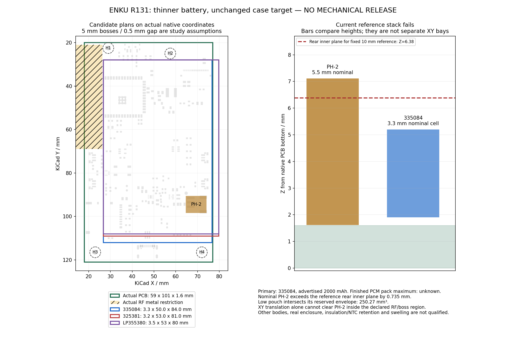

# ENKU Base R131: thinner battery, fixed enclosure thickness

**Select Koosay 335084 as the provisional engineering cell candidate: advertised 2000 mAh, nominal T3.3 × W50 × L84 mm.** Retain a replaceable two-wire, 1S 4.20 V protected pack with a separate cell NTC. Case thickness must not increase. This is a layout choice, not an approved protected-pack SKU or permission to buy/manufacture.

The candidate is 0.7 mm thinner at the catalogue-cell level than the 4.0 mm candidates reviewed in R130. The finished PCM pack's maximum thickness, minimum capacity, exact chemistry/charge limit and stock availability are still unconfirmed. The supplier currently lists zero stock cells for both leading options. Do not describe either as an available standard finished battery.

## Comparison and primary sources

Dimensions below are T × W × L. Catalogue cell dimensions are not maximum finished-pack dimensions.

| Candidate | Advertised capacity | Dimensions, mm | Decision |
|---|---:|---|---|
| [Koosay 335084](https://koosay.com/pages/lipo-battery-models-64) | 2000 mAh | 3.3 × 50 × 84 | Primary: narrower plan lies inside the actual PCB outline at the trial origin; packaging remains HOLD. |
| [Koosay 325381](https://koosay.com/pages/lipo-battery-models-66) | 2000 mAh | 3.2 × 53 × 81 | Thinnest reviewed Koosay cell within the earlier 53 × 85 request; only 0.1 mm thinner but 3 mm wider. Retain as alternative if actual enclosure CAD proves lateral room. |
| [Polybattery LP355380](https://polybattery.com/2000mah-lipoly-battery-used-for-hand-held-power-scrubber) | 2000 mAh | 3.5 × 53 × 80 | Existing model-specific RFQ; wider and thicker than primary. |
| [Koosay 315088 / 305092](https://koosay.com/pages/lipo-battery-models-64) | 2000 mAh | 3.1 × 50 × 88 / 3.0 × 50 × 92 | Thinner but too long for the declared mounting-boss region. 315088 intersects the assumed H4 boss margin. |
| [Koosay 275298](https://koosay.com/pages/lipo-battery-models-66) | 2000 mAh | 2.7 × 52 × 98 | Too long for this region; thickness alone is insufficient. |
| [Koosay 405381](https://koosay.com/pages/lipo-battery-models-66) | 2500 mAh | 4.0 × 53 × 81 | Retained R130 comparison; loses the thickness and width advantage. |

Seven primary Koosay catalogue pages 60–66 contain **3500 unique rows**. The scan retained 38 rows advertising 2000–2500 mAh at T≤3.5 mm; 10 also fit the earlier nominal W≤53/L≤85 request. This is a bounded catalogue scan, not a claim about every battery on the market. Source URLs, retrieved-page SHA256/byte counts, all 38 factual rows and additional primary findings are retained in [source register](../hardware/mainboard/bom/battery_sources_R131.json).

LiPol-branded pages disagree whether LP295386 (2.9 × 53 × 86 mm) has 2000 or 1500 mAh; exclude it until an exact controlled specification resolves the conflict. Repeated same-brand websites do not constitute independent confirmation. A documented FPBattery DNK3065100 protected 2000 mAh pack is 3 mm thick but 65 × 102 mm in plan, unsuitable here. Jauch LP504783JU is 2050 mAh but 5.2 mm thick. R130 Akyga AKY0156 remains too thick at a finished maximum 5.2 mm and requires a connector change from its SYP interface.

## Check against actual KiCad geometry

The canonical **R130 KiCad source is unchanged**. The audit checks its PCB SHA256, CRC and SHA256 of the actual retained native CI artifact, exact equality of server geometry and the committed checkpoint, and the native STEP's identity. Geometry is from actual KiCad 10.0.7 output, not a redrawn board approximation. CadQuery checks a nominal battery brick against the conservative nominal PH-2 reservation. This is not a complete component/enclosure assembly or a new KiCad native CI run.

Actual board: **59 × 101 × 1.6 mm**, X18–77/Y20–121. Actual antenna metal restriction reaches X26.25 at Y21–69. Trial cell origin is X26.75/Y28. The study retains R130's assumed 5 mm bosses and 0.5 mm plan gap; actual boss/enclosure dimensions have not been registered.

| Trial at the same origin | 335084 | 325381 | LP355380 | 315088 |
|---|---:|---:|---:|---:|
| Overhang beyond actual PCB right edge | 0 mm | 2.75 mm | 2.75 mm | 0 mm |
| Shortfall against the assumed 0.5 mm right-edge gap | 0.25 mm | 3.25 mm | 3.25 mm | 0.25 mm |
| End room before H4 boss + gap | 1.5 mm | 4.5 mm | 5.5 mm | −2.5 mm |
| Nominal PH-2 reserved-volume intersection | 250.272 mm³ | 242.688 mm³ | 265.440 mm³ | 235.104 mm³ |

The primary fits the board outline but **does not pass all declared clearances**. Neither its PCM, pouch tolerances, wires nor the NTC attachment is included in the catalogue dimensions. The 3 mm width advantage is more useful in this layout than the alternative's 0.1 mm thickness advantage.

An interval proof covers continuous translations, not just sampled positions: a 50 × 84 mm cell wholly inside the board and outside the RF restriction must start at X26.25–27; assumed H2/H4 bosses constrain Y28–29.5. Every such rectangle overlaps the current J1 reservation. Translation of the pouch alone cannot solve the conflict within those declared boundaries.

The historical SCAD targets **10 mm** but uses obsolete board/battery dimensions. Treat 10 mm solely as a fixed reference stack, not verified current case CAD. With retained front wall 1.0, display 0.92, front gap 0.5 and rear wall 1.2 mm assumptions, rear inner Z is 6.38 mm. The nominal current PH-2 top from native STEP is Z7.114998: **0.734998 mm above the reference inner plane even without stacking the pouch over it**. Placing the cell low at Z1.9 does not remove its XY intersection. R130's taller overlay scenarios are historical studies; they are not an accepted increase of the case.

[Audit JSON](../hardware/mainboard/mechanical/thin_battery_audit_R131.json) and [intentionally failed STEP trial](../hardware/mainboard/mechanical/thin_battery_fixed_10mm_failed_trial_R131.step) preserve the conflict. The STEP includes the actual native board and a nominal PH-2 envelope plus the catalogue-cell brick; it does not contain all component bodies or a vendor-qualified battery model.

## What moves forward

Use **50 × 84 × 3.3 mm nominal cell** for the next fixed-thickness layout study. Resolve the battery/connector arrangement and tall-component packaging within the unchanged case target, using real panel/FPC/component bodies and the finished-pack maximum drawing before altering PCB placement. Allow no case-thickness increase and no capacity reduction below the 2000 mAh requirement. Confirm the current enclosure geometry; do not silently substitute the obsolete SCAD assembly.

Rechecked all three existing sent RFQs to Koosay, Polybattery and Akyga/Ropla: each still has one outgoing message, no incoming reply and no attachment at this pass. The Koosay enquiry already asks for closest alternatives, and the Polybattery enquiry explicitly includes LP355380. **Zero new messages or orders.** Use those threads for vendor evidence when responses arrive.

For the chosen model, require a controlled 4.20 V specification, minimum/rated capacity, maximum finished PCM dimensions, protected-pack MPN/availability, load/current limits, polarity drawing and transport documents. Retain PH-2 two-wire service compatibility and the separate physical NTC. The current 103JT/B3435 direct TS path does not establish a 0–45 °C hardware inhibit; the approximately 300 mA / 360 min timer also needs a demonstrated full 2000 mAh charge cycle. These are existing R130 gates, not solved by the thinner cell.

Reproduce with `python hardware/mainboard/mechanical/audit_thin_battery_R131.py` from the repository. This pass used Python 3.12.14, CadQuery 2.7.0 and Matplotlib 3.10.8. PNG was CRC-verified and visually reviewed; STEP is checked independently by re-import. Analytical checks pass by identifying the declared failed layout. **Mechanical acceptance, purchase release and fabrication_ready remain false.**
