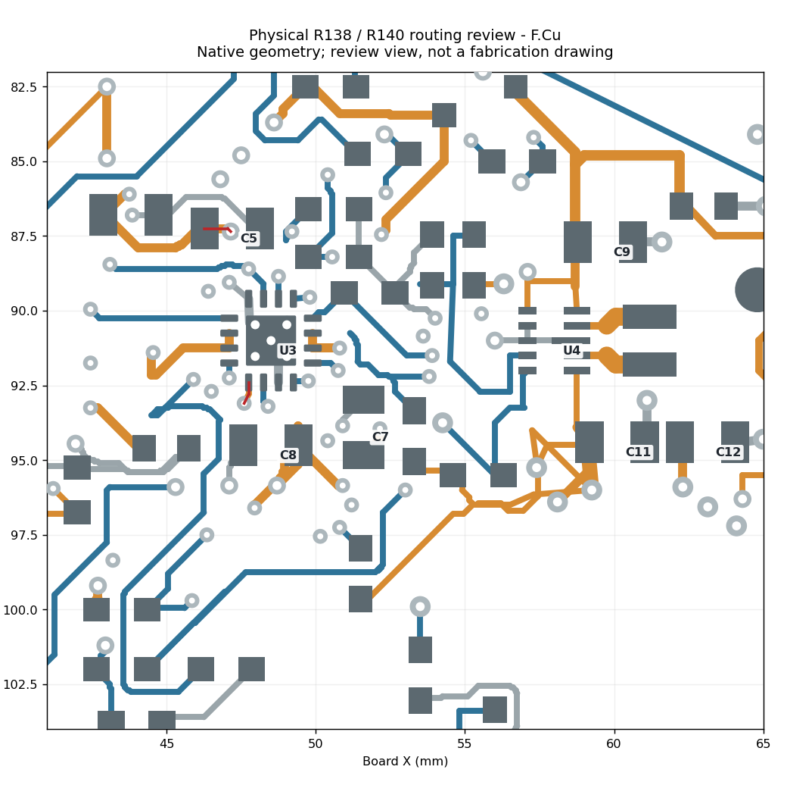
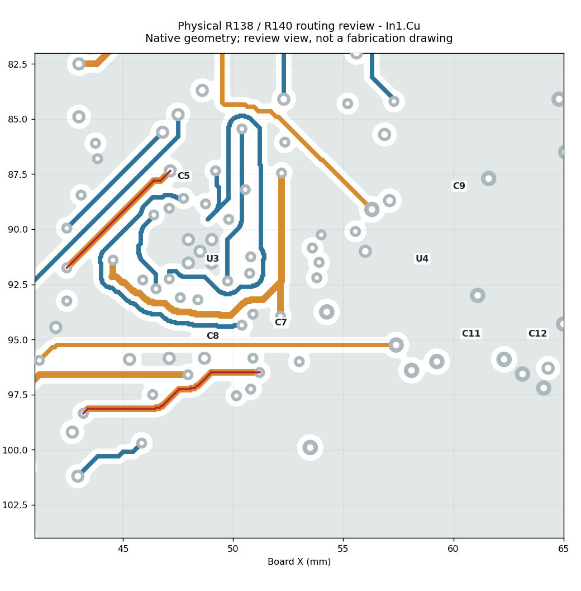
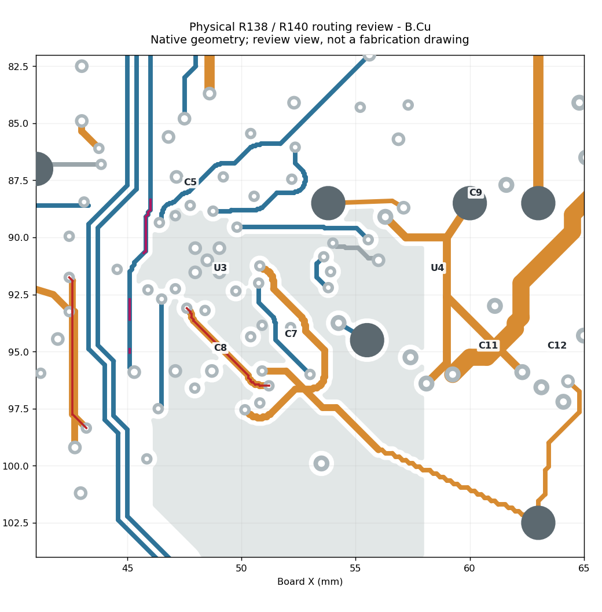
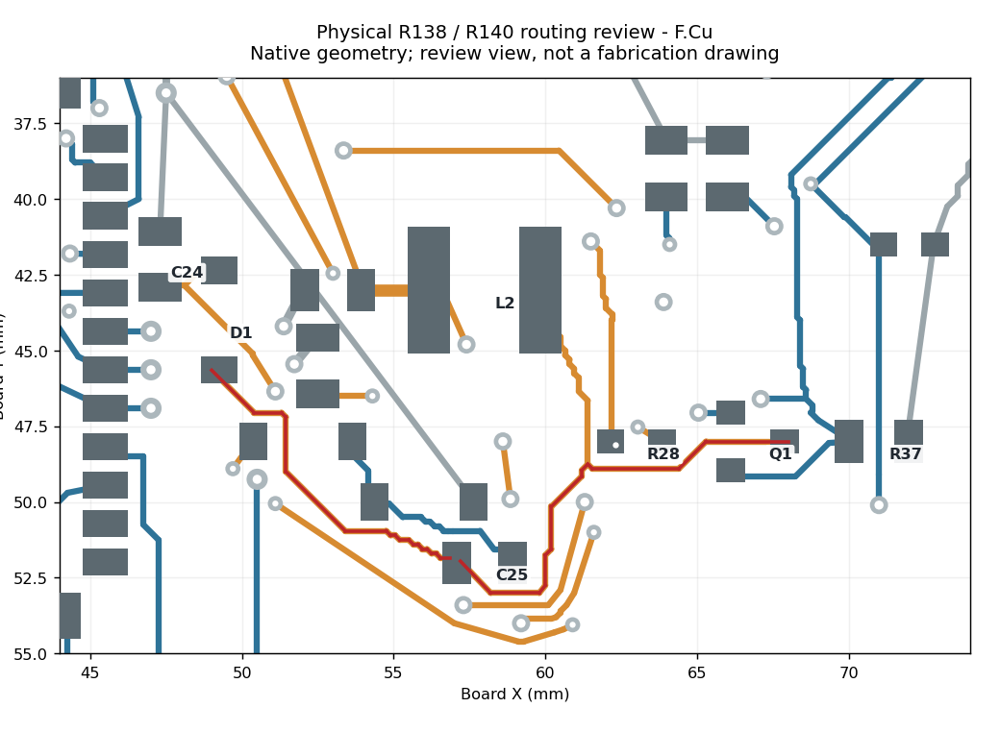
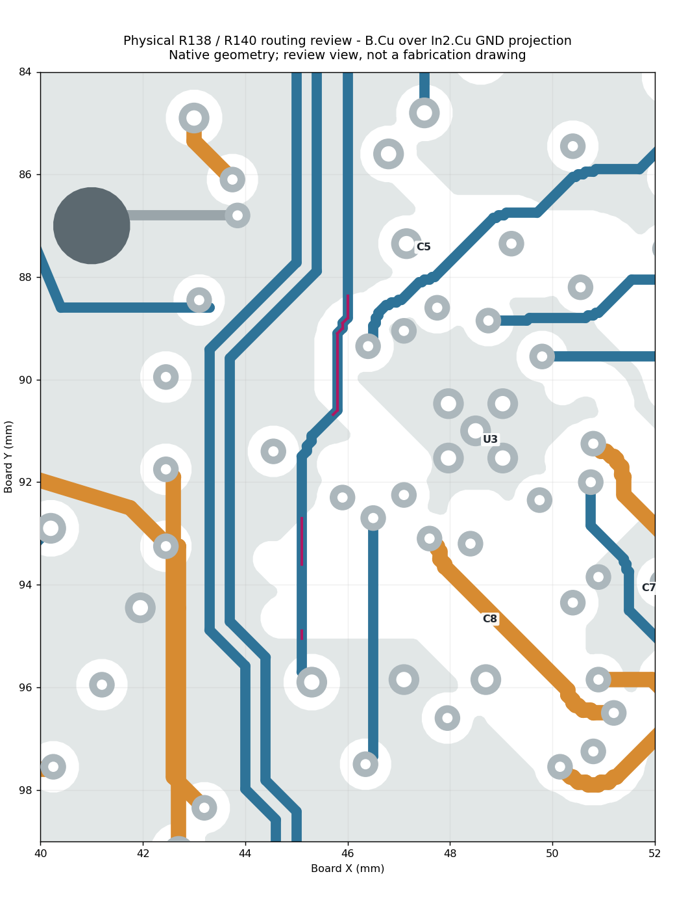

# R140 — повторная проверка всей платы ENKU Base Reader

13 октября 2026. Проверена физическая плата **R138**, исходник `main` на `fb21e37500f3f50ed842ea01bc939c3a72fc5428`. Работа сохранена отдельно в `engineering/r140-board-routing-review`. **NO FAB**: найденные замечания по разводке ещё не исправлены; физические испытания не выполнены.

Повторный Native KiCad прошёл, но этого недостаточно для выпуска готового устройства. Перед производством необходимо сократить соединения конденсаторов зарядника, уплотнить импульсный узел EPD и восстановить опорную землю быстрых линий SPI. Лишние ступеньки вторичны относительно этих трёх задач.

## Что действительно проверено

| Проверка | Результат |
| --- | --- |
| KiCad 10.0.7: DRC / ERC / незамкнутые соединения / соответствие схеме | **0 / 0 / 0 / 0** после нового полного запуска |
| Все 27 существующих областей проверки R138 | PASS; исходный контрольный набор не перегенерирован |
| Проверки с намеренно внесёнными дефектами | Все **20** отклонены нужной проверкой после успешного положительного примера; ошибки окружения не засчитывались |
| Независимое сравнение с сохранённым серверным результатом | 28 отчётов, 8 нормализованных Native SVG и все 24 производственных файла совпадают; исключены только явно проверенные экспортные временные метки |
| Полная геометрия маршрутов | **77 цепей с дорожками, 3383 сегмента, 329 переходных отверстий**; все четыре медных слоя |
| Явно измеренные соединения площадка–площадка | **30** маршрутов; неразрешённых моделей нет |
| Семантика графа маршрутов | 3 независимых геометрических примера: одинаковые XY на разных слоях не соединяются без via; настоящее via соединяет; пересечение посередине сегментов на одном слое соединяет |
| Производственные и компонентные проверки | 11 Gerber-слоёв, 354 отверстия/паза, 753 IPC-записи, 107 устанавливаемых позиций / 58 BOM-групп, 19 bare-позиций, R67 DNP и шесть специальных fill/cap-позиций сохранены |
| Исходник платы, схема, правила, библиотеки и workflow | Не изменены; PCB SHA256 `90d6e0ccd729ac6e916e7f24e173d52a316c3cd640128ea5d6df1f0fcafa8971` |

Это **новый локальный** прогон, сопоставленный с реально сохранённым [серверным запуском 38356800482](https://github.com/aliaksei-lameyka/ENKU-Base-reader/actions/runs/38356800482), исходник `43a19802074b249ef29fd31211ede7e863c8e204`. Новый серверный CI в этом отчёте не заявляется. Последующие изменения `main` до `fb21e37` затрагивали документацию; электрический исходник совпадает.

[Протокол и точное происхождение](qualification/R140/verification_R140.json), [сравнение с сервером](qualification/R140/accepted_server_comparison_R140.json), [полный новый Native-результат](evidence/R140/native_local_R138_recheck.zip), [все цепи](qualification/R140/all_track_nets_R140.csv), [координаты, UUID и модели маршрутов](qualification/R140/routing_review_R140.json).

## Приоритет 1 — локальная развязка зарядника U3

Физически близкая установка конденсатора не обеспечивает короткого электрического соединения. Путь положительного вывода C5 к IN зарядника обходит соседние цепи через несколько слоёв и получается около **29 мм**, хотя расстояние между центрами площадок около **5 мм**. У остальных входных конденсаторов короткой альтернативы в модели также нет.

| Цепь | Путь по меди, мм | Расстояние между центрами площадок, мм |
| --- | ---: | ---: |
| C5.1 → U3.13, VBUS_USB | 29.094 | 5.357 |
| C6.1 → U3.13, VBUS_USB | 22.261 | 4.134 |
| C4.1 → U3.13, VBUS_USB | 32.777 | 7.425 |
| C2.1 → U3.13, VBUS_USB | 29.038 | 12.187 |
| U3.10 → C7.1, VSYS | 16.688 | 6.071 |
| C8.1 → U3.2, VBAT | 12.504 | 3.285 |

[TI BQ24072T, Rev C, §12.1, стр.33](https://www.ti.com/lit/ds/symlink/bq24072t.pdf) требует близких IN/OUT-конденсаторов и коротких соединений к IC/земле, а также подходящего сечения силовых дорожек. Текущие измерения дают обоснованный повод переразвести этот участок до производства. Они не доказывают уже измеренную неустойчивость зарядника: плата на стенде не испытывалась.

Действие: организовать короткое прямое соединение IN–локальная ёмкость и OUT–локальная ёмкость; проверить возврат к exposed pad/GND и пути тока USB/BAT/SYS. Сохранить разделение чувствительных TS/ISET/ILIM-цепей и силовых токов. После изменения заново проверить всю плату и экспорт, а на образцах — подключение USB, броски нагрузки, заряд, DPPM/VINDPM и нагрев.

Красным выделена **фактическая положительная ветвь C5.1–U3.13**; три изображения относятся к разным слоям одного маршрута, а не к трём отдельным соединениям. Серый фон — медь соответствующего слоя.





## Приоритет 1 — импульсный узел EPD

`EPD_SW` распределён между Q1, L2, D1 и C25 на значительной площади. Путь Q1.3–D1.2 составляет **26.458 мм** при прямом расстоянии **18.784 мм**; Q1.3–L2.2 — **11.308 мм**, Q1.3–C25.1 — **14.985 мм**. Вся цепь содержит 53 сегмента общей длиной около 33.33 мм.

Здесь требуется пересмотреть взаимное положение компонентов и площадь импульсных соединений. Выпрямление нескольких ступенек не устранит расстояние между ключом и диодом. Нужно проверить размещение относительно FPC, входную ёмкость C22, возврат и чувствительный узел R37; точный конечный вариант привязать к согласованному модулю дисплея и его документации. Ни величина выбросов, ни допустимая нагрузка по геометрии не измерены.

Действие: уплотнить активный узел без изменения толщины корпуса и без нарушения механики дисплея/антенны, затем подтвердить запуск HV, напряжения и пульсации при обновлении панели, выбросы на Q1/D1 и импульсный нагрев R37.

Красным выделен фактический путь Q1.3–D1.2; изображение содержит настоящее расположение площадок и дорожек.



## Приоритет 1 — опорная земля SPI и переходы слоёв

Проверено покрытие наружных сигнальных дорожек фактической заполненной землёй: для F.Cu ближайший слой In1.Cu, для B.Cu — In2.Cu. Собственные antipad сигнальных via исключены по явно указанной геометрии. Наличие земли на более далёком внутреннем слое учитывается отдельно и **не считается электромагнитно равноценной заменой** ближайшего слоя.

| Цепь | Сумма всех сегментов цепи, мм | Без ближайшей внутренней земли, мм | Без земли на обоих внутренних слоях, мм |
| --- | ---: | ---: | ---: |
| SPI_SCLK | 90.701 | 14.261 | 3.492 |
| SPI_MOSI | 98.814 | 4.859 | 1.255 |
| SPI_MISO | 73.866 | 0.631 | 0 |
| EPD_MOSI_PANEL | 48.880 | 11.176 | 0 |
| SD_CS | 60.201 | 8.381 | 0 |
| SD_SCLK_CARD | 13.780 | 0.701 | 0 |

Это суммы по всей разветвлённой цепи, не задержка одного соединения. Явные пути U1–microSD: SCLK **69.383 мм**, MOSI **63.366 мм**, MISO **73.866 мм** до соответствующих последовательных резисторов. По одной длине нельзя установить допустимую частоту: существенны фронты GPIO, нагрузка, ответвления и положение согласующих резисторов.

На SCLK проблемные интервалы находятся на B.Cu примерно при X=45.1–46.0, Y=88.36–95.05; на MOSI — на F.Cu примерно X=42.50–43.55, Y=45.60–46.10. Точные отдельные интервалы и UUID находятся в JSON. Для части быстрых межслойных переходов ближайший GND-barrel находится в 8–9.5 мм: это координатный показатель для пересмотра возврата, а не установленный предел стандарта.

Действие: создать непрерывную ближайшую опорную землю, убрать обходы у её разрезов, поставить GND-переходы рядом с необходимыми сигнальными переходами после проверки зазоров. Проверить общую SPI-топологию SD/EPD и положение резисторов относительно источников фронтов. [Рекомендации Espressif для ESP32-S3](https://docs.espressif.com/projects/esp-hardware-design-guidelines/en/latest/esp32s3/pcb-layout-design.html) использовать вместе с реальными скоростями/осциллограммами; ограничения SDIO не переносить автоматически на microSD в режиме SPI.

На изображении фон — проекция настоящей земли In2.Cu под дорожками B.Cu. Пурпурным показаны участки без земли на обоих внутренних слоях; это не физический дополнительный проводник.



## Приоритет 2 — питание MCU и аккуратность маршрутов

Путь 3V3_SYS U4.6–U1.2 составляет **101.094 мм** при прямом расстоянии **48.451 мм**. При условных 35 мкм меди и 20°C модель сопротивления только дорожек даёт около **72.75 мОм**; условное падение при 0.5 А — **36.38 мВ**. Эти числа не включают via, площадки, компоненты, температуру, возврат, распределение токов и фактический stackup. Это повод проверить сечение/маршрут и падение на нагрузке, а не результат измерения устройства.

Локальная разводка TPS63802 не имеет такого же длинного входного маршрута: C9.1–U4.10 **2.302 мм**, U4.6–C11.1 **1.900 мм**, обе связи L1–U4 около **2.574 мм**. Путь к C12 **9.010 мм**, к делителю FB **9.116 мм**. При дальнейшем перемещении силовых цепей сохранить короткие связи C9/C11/L1 и проверить землю/FB по [TI TPS63802, Rev D, §11.1, стр.28](https://www.ti.com/lit/ds/symlink/tps63802.pdf).

По всей плате отмечено **115 геометрических кандидатов** на упрощение: цепочка минимум из шести сегментов, длиннее свободной прямой более чем на 0.25 мм. Это **не 115 доказанных ошибок**. Свободная прямая не учитывает другие дорожки, корпуса, ответвления, зазоры и назначение цепи; автоматически заменять её нельзя. Аналогично 49 отметок опорной земли относятся к отдельным сегментам, а не к 49 обрывам.

Последовательность уборки: сначала силовые и импульсные связи и быстрые линии; затем низкоскоростные GPIO, кнопки и служебные цепи. После каждого изменения проверять весь граф соединений, заполнять зоны и запускать полный Native-прогон. Аналоговые TS/FB/ISET/ILIM не объединять с возвратом импульсных токов ради внешне короткой линии.

## Что в этом проходе не вызвало новых нарушений

USB4215-03-A — **J5**. Все группы USB-C контактов подключены, полярность/ESD соответствуют проверенным схемам. Длинная пара проходит на B.Cu над In2.Cu, ширина/зазор около 0.2/0.2 мм; проверка всей полосы опорной земли не нашла отсутствующих областей. Геометрия USB-A/B ответвлений сохранена. **90 Ом и качество сигнала ещё не квалифицированы** без производственного stackup и испытаний.

Повторные проверки также сохранили pin map Q1/SW1, номинальную геометрию компонентов и разъёмов, антенную зону U1, контур и отверстия, annular ring, пасту/маску и DNP, J7 UART/BOOT/EN, прямой PH-2 J1 и отдельный NTC J8. Это источник/геометрия/экспорт, а не доказательство успешной сборки и запуска.

Четыре полных вида: [F.Cu](qualification/R140/visuals/layer_F_Cu_R140.png), [In1.Cu](qualification/R140/visuals/layer_In1_Cu_R140.png), [In2.Cu](qualification/R140/visuals/layer_In2_Cu_R140.png), [B.Cu](qualification/R140/visuals/layer_B_Cu_R140.png). Они созданы из действительной Native-геометрии; это обзорные изображения, не Gerber-файлы и не производственные чертежи.

## Оставшиеся условия выпуска

Новые замечания по разводке добавляются к ранее открытым условиям: запуск USB100 с пустой прошивкой и слабой/отсутствующей батареей; EN/reset и быстрые циклы; эффективная ёмкость и совместная нагрузка Wi-Fi/SD/EPD; реальный CC/CV/таймер/NTC, обрыв R82 и отрыв датчика от горячего пакета; две взаимозаменяемые тонкие PCM-батареи с закупкой в Китае/Польше; окончательный корпус/панель/FPC; согласованный stackup, 0.20-мм отверстия, fill/cap, короткие USB-стойки и трафарет; проверенные firmware, fixture и численные FCT-пределы. См. [план квалификации](PRODUCT_QUALIFICATION_R139.md) и [состояние батарей](BATTERY_STATUS_R139.md).

Следующий инженерный этап — три локальные доработки выше, затем новый контролируемый аппаратный checkpoint и весь Native-набор. Существующий R138 нельзя объявить завершённой потребительской платой по одному DRC. Производственный пакет, уже переданный пользователю, остаётся пакетом **для расчёта цены и DFM**; аппаратные изменения потребуют отдельного нового полного экспорта.

## Повторение анализа

Использовать точный KiCad 10.0.7, Shapely 2.2.0, NumPy 2.3.5 и Gerbonara 1.6.3. `ENKU_KICAD_APP` задаёт абсолютный путь к `AppRun`; `PYTHON` — интерпретатор окружения с этими зависимостями. Native-результаты сохранять вне проекта, не перезаписывать frozen checkpoint.

```bash
"$PYTHON" hardware/mainboard/kicad/checks/run_native_current.py \
  hardware/mainboard/kicad /absolute/path/R140_NATIVE
"$PYTHON" hardware/mainboard/kicad/checks/test_release_guards_R138.py \
  hardware/mainboard/kicad /absolute/path/R140_NATIVE
"$PYTHON" hardware/mainboard/kicad/checks/review_routing_R140.py \
  hardware/mainboard/kicad /absolute/path/R140_NATIVE docs/qualification/R140
python3 hardware/mainboard/kicad/checks/render_routing_R140.py \
  /absolute/path/R140_NATIVE docs/qualification/R140/routing_review_R140.json \
  /absolute/path/R140_VISUAL
```

Рендер требует Matplotlib 3.10.8. Метод измеряет кратчайшие пути осевых линий на реальных слоях; металлическая связь внутри площадки имеет нулевую модельную длину. Поэтому длина может быть меньше расстояния между центрами двух площадок. Межслойная связь разрешена только через физические via/PTH; модель не рассчитывает электромагнитные поля, волновое сопротивление, перегрев или запас работоспособности.

В этом проходе плата и выданные PCBWay-файлы не менялись. Заказы, производство, загрузка на фабрику и новые письма поставщикам не выполнялись.
